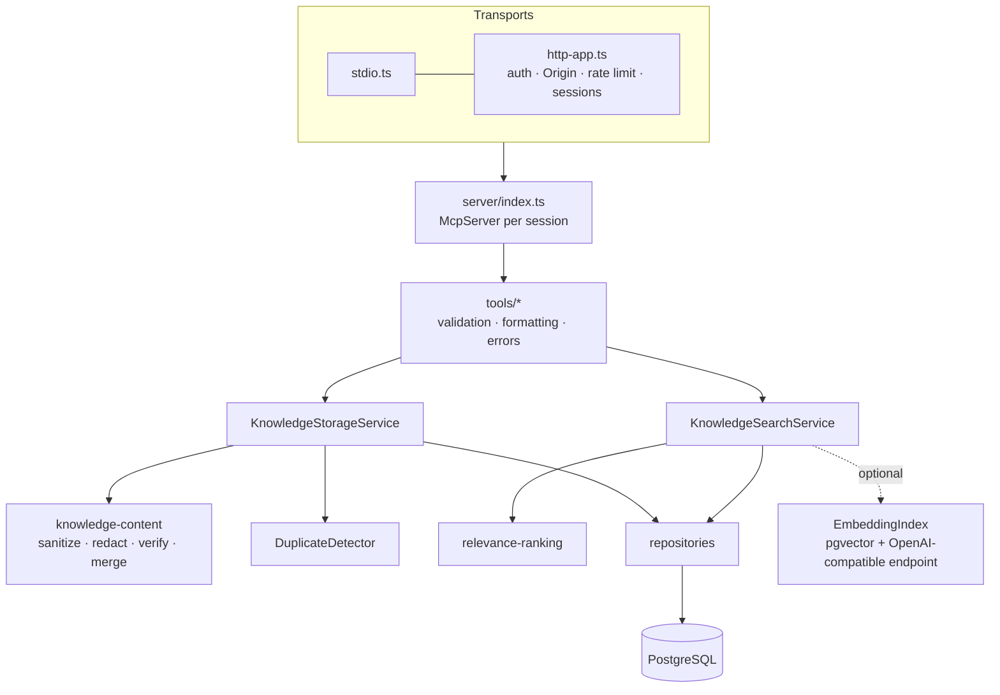

# Architecture and design decisions

## Components

The AI client does the reasoning; the server handles retrieval, persistence, search, and access control. There is
no model call anywhere in the server. Dependencies are wired explicitly in `server/bootstrap.ts` (no singletons).

## Data model (single database)

| Table | Purpose |
| --- | --- |
| `users`, `api_tokens` | Stable identities (user, organization, role, public-read permission) and SHA-256 token hashes. |
| `knowledge_documents` | Current version: title, sections (JSONB), rendered Markdown, summary, hashes, visibility, namespace, generated `tsvector`. |
| `knowledge_versions` | Every version's Markdown, sections, change summary, author, and client. |
| `document_tags` | Normalized tags. |
| `document_grants` | Explicit read/write grants (private sharing, cross-org sharing). |
| `document_stats`, `knowledge_feedback` | Hot counters kept apart from the wide document row, plus per-user, per-version feedback. |
| `audit_log`, `usage_daily` | Metadata-only audit trail and persistent usage counters. |
| `knowledge_embeddings` | Optional; created only when embeddings and pgvector are available. |

Markdown is stored in PostgreSQL rather than on a filesystem, so hosted restarts lose nothing.

## Retrieval and ranking

`search_repository.ts` runs one query that unions access-filtered candidates from: exact title key → full-text
(`english`, OR semantics over safe tokens) → `pg_trgm` title similarity → tag matches → optional pgvector. It then
computes raw signals for that small set only. `relevance-ranking.ts` (pure, unit-tested) combines them:

- relevance = 0.45 · query-term coverage + 0.20 · title coverage + 0.20 · trigram + 0.15 · tag overlap
  (exact title = 1; semantic similarity can only raise it);
- score = relevance × quality, quality ∈ [0.70, 1.00] from verification, smoothed feedback, and freshness
  (half-life 180 days); stale documents (old, or more outdated reports than helpful ones) get a 10% penalty.

Quality never makes an irrelevant document relevant, and results carry confidence and match reasons so the AI can
judge whether a previous solution applies.

## Writes

- **Sanitize → redact → normalize** every field (`knowledge-content.ts`); prompt-injection-like text is flagged, not
  silently dropped.
- **Verification is evidence-based**: "verified" without evidence is stored as unverified; changing the solution
  without new evidence resets verification.
- **Duplicates**: exact fingerprint (normalized problem + solution), re-checked inside the insert transaction under
  an advisory lock; near duplicates by title/problem similarity → `on_duplicate` decides.
- **Updates** are optimistic (`expected_version`), merge or replace, and always append a version row.

## Access control

Read policy lives in one SQL predicate (`readablePredicate`) used by every query, with a TypeScript mirror for
documents loaded by id. Unreadable and missing documents return the same "not found" message.

| Action | private | shared | public |
| --- | --- | --- | --- |
| Read | owner, grantees | + same organization | + users with public-read permission |
| Update | owner, write-grantees | + org members (collaborative; history kept) | owner, org admins |
| Archive / delete | owner | owner, org admins | owner, org admins |
| Create | members, admins | members, admins | admins only |

Readers (`role=reader`) can search, read, and give feedback, but cannot write.

## Token optimization

Summaries first; `sections`, `max_chars`, and `if_none_match` on `get_knowledge`; already-shown results collapse to
one line within a session; search results are cached per identity with invalidation on every write; duplicates are
prevented; ids are referenced instead of resending content. Usage counters (searches, latency, cache hits, reuse,
duplicates avoided, estimated vs. measured tokens) are buffered in memory and persisted to `usage_daily`.

## Key trade-offs

- **Bearer tokens instead of OAuth**: simple for CLIs and agents; OAuth 2.1 is on the roadmap for hosted connector UIs.
- **Stateful sessions by default**: enables per-session de-duplication; `stateless` mode exists for PaaS cold starts.
- **Shared documents are collaborative**: favors improving one document over many near duplicates; every change is
  versioned and attributed.
- **`english` text search configuration**: good stemming for technical English; other languages rely on trigram/tags.
